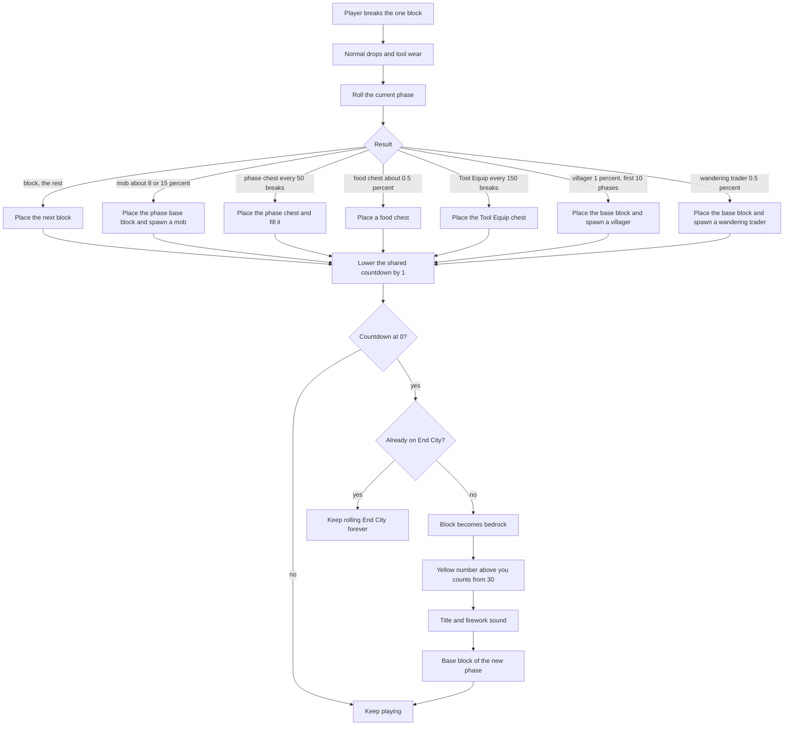

# One Block gameplay

You spawn in Survival with empty hands on one grass block over the void. Breaking that block gives the normal Minecraft drop, then a new result from the current phase appears in the same spot. There is one block and one phase for the whole world. Any player breaking that block spends a break for everyone. The 300 breaks are counted in the background and are never shown on screen. Phases 1 through 14 each last 300 shared breaks. Phase 15 then stays forever and the block keeps regenerating. There is no trophy, victory chest, or stop.

The download is a void world, `One Block.mcworld`, with both packs already turned on. The source stays in `behavior_pack` and `resource_pack`.

When you import the world, the only solid block is the grass block at `0, 64, 0`. Everything else is air. There is no bedrock floor, no extra platform, no trees, and no structures.

## How a break works

The only special block is the one at `0, 64, 0`. Anything you build around it is normal.

- Every phase has at least two hostile mobs and at least two passive mobs. A mob can be on more than one phase when it fits more than one place, so zombies and skeletons show up across the Overworld, and striders show up in both Nether phases. Besides the 1 percent villager roll in the first 10 phases and the 0.5 percent wandering trader in every phase, the mobs listed on a phase are the only ones that phase can spawn. Ancient City has no warden.
- Early phases roll mobs less often. From Deep Cavern on, hostile mobs are the common mob roll. Passive mobs still spawn in every phase.
- In the Meadow through the Lush Cave, each break has a 1 percent chance to spawn a villager instead of the normal block or mob. Food chests and the every-50 phase chest still come first. Ancient City and every phase after it do not spawn villagers.
- Every phase, including the Nether and the End, has a 0.5 percent chance on each break to spawn a wandering trader instead of the normal block or mob. That is about 1 in 200 breaks. A food chest, the every-50 phase chest, or a villager still comes first when that break is one of those.
- A chest stays until someone breaks it. Breaking it counts as the one-block break and rolls the next result.
- A normal phase chest appears on every 50th break that is not a food chest. The count is shared and keeps going across phases. Food chests do not count toward those 50 breaks. If that break is also the Tool Equip chest, Tool Equip is placed and the phase chest waits until the next break.
- A Tool Equip chest appears on every 150th break, in every phase. It is a chest, and its name is Tool Equip instead of Chest. It holds one full set of armor: helmet, chestplate, leggings, and boots, plus a sword, an axe, and a pickaxe. Each piece is rolled on its own. Armor is leather 25 percent, chainmail 25 percent, gold 20 percent, iron 20 percent, diamond 7 percent, and netherite 3 percent. The sword, axe, and pickaxe use that same spread, with wood and stone in place of leather and chainmail.
- A phase chest lists the items for that phase, but each ordinary item is left out about 40 percent of the time, so two chests from the same phase will not match. Every normal chest still ends up with at least 7 items. Heart of the sea, enchanted golden apple, and elytra stay rare extras, about a 12 percent chance each, and they do not count toward those 7. Items that do not stack are always 1 when they appear: shears, iron pickaxe, stone pickaxe, fishing rod, shield, name tag, leather armor, bucket, iron leggings, fire resistance potion, and elytra.
- Stackable items still roll a count from 1 to 10. One is the usual amount, about 60 percent of the time. Two is uncommon, and each higher count is rarer, with 10 the rarest.
- The one block is not an even mix. A block that is common in normal Minecraft, such as dirt, stone, sand, or netherrack, shows up much more often than a scarce one, such as diamond ore, emerald ore, a sea lantern, or crying obsidian.
- About 0.5 percent of breaks, in any phase, place a food chest instead of the normal roll. This does not change the phase chests or the 50-break chest count. A food chest holds bread, cake, potatoes, and carrots. Half of those chests also hold a golden apple, which grants extra hearts. Food stacks use the same 1-to-10 curve, so one of each is the usual amount.
- There is no blocks-left counter. No action bar, scoreboard, or title shows how many breaks remain. The world still counts those 300 breaks in the background, and a break by any player lowers that hidden count for everyone.
- When the hidden count hits 0, the phase transition starts. The one block becomes bedrock. A yellow number floats above your head and counts down from 30 seconds. Bedrock cannot be broken, so the shared count stays still during those 30 seconds. At 0, the number disappears, every player sees the new phase title, and the firework blast sound plays. The bedrock then becomes the new phase's base block. Phases 1 through 14 start their next 300-break countdown only after this transition ends.
- Entering End City uses that same transition. After it ends, End City has no countdown, because it does not end. Later breaks still roll End City for everybody, with no further transition.
- Sand, gravel, and other gravity blocks can fall. That does not add to the count. A short moment later, if the spot is empty, the phase base block is put back so the platform is not gone. Creepers are handled the same way.
- Breaking the one block gives the normal Minecraft drop for that block and for the tool you used. Stone gives cobblestone. Iron ore gives raw iron. Leaves give nothing unless you use shears or Silk Touch, which give the leaves. The right pickaxe is required for stone and ores, and Fortune and Silk Touch work the normal way. A chest still breaks the normal way, so the chest and everything inside it drop.
- Saplings, seeds, flowers, mushrooms, vines, and other things that are not full blocks never become the platform. They show up inside that phase's chest.
- Every phase has at least six different full blocks that fit that phase. The same block can appear in more than one phase.
- If you are standing on the one block when you break it, only you are placed half a block above the new block. Other players stay where they are.
- A tool loses durability when it breaks the one block. Unbreaking makes that less common. The tool disappears when its durability runs out. Breaking a chest still uses the normal durability loss.
- You start with an empty inventory. The first block is grass. Dying drops your items where you died, then you respawn on the center of the one block. Items that fall into the void are lost. The phase and break count do not reset. If the spot is air, the phase base block is restored and the count stays the same.
- Natural mob spawning is off. Only phase rolls spawn mobs. Difficulty is Normal.

## The 15 phases

Phases 1 through 14 are exactly 300 shared breaks each. Whoever breaks the one block spends one of those breaks for the whole world. Progress is stored on the world, so it survives saving and a player who joins later arrives in the current phase. They are not shown how many breaks are left. After break 4,200, End City never ends and the block keeps regenerating for everyone.

Every phase has at least two hostile mobs and at least two passive mobs. Both lists are required.

### Mob roster

1. **Meadow** — Hostile: zombie, skeleton. Passive: pig, cow, mooshroom, sheep, chicken. Villager: 1% of breaks.
2. **Dark Forest** — Hostile: spider, zombie, skeleton. Passive: pig, chicken. Villager: 1% of breaks.
3. **Stone Mine** — Hostile: silverfish, zombie, skeleton. Passive: glow squid, bat. Villager: 1% of breaks.
4. **Deep Cavern** — Hostile: zombie, skeleton, creeper. Passive: glow squid, bat. Villager: 1% of breaks.
5. **Warm Ocean** — Hostile: drowned, guardian. Passive: squid, turtle, tropical fish. Villager: 1% of breaks.
6. **Desert Temple** — Hostile: husk, skeleton, creeper. Passive: rabbit, camel. Villager: 1% of breaks.
7. **Jungle Temple** — Hostile: zombie, skeleton. Passive: ocelot, parrot, panda, mooshroom. Villager: 1% of breaks.
8. **Swamp Hut** — Hostile: slime, witch, zombie. Passive: frog, chicken. Villager: 1% of breaks.
9. **Frozen Peaks** — Hostile: stray, zombie. Passive: goat, rabbit, fox. Villager: 1% of breaks.
10. **Lush Cave** — Hostile: zombie, skeleton, drowned. Passive: axolotl, glow squid, mooshroom. Villager: 1% of breaks.
11. **Ancient City** — Hostile: zombie, skeleton. Passive: sniffer, glow squid.
12. **Nether Wastes** — Hostile: zombified piglin, magma cube, ghast. Passive: strider, happy ghast.
13. **Crimson Forest** — Hostile: hoglin, zombified piglin. Passive: strider, happy ghast.
14. **The End** — Hostile: enderman, endermite. Passive: allay, bat.
15. **End City** — Hostile: shulker, enderman. Passive: allay, bat.

Every phase also has a 0.5 percent chance to spawn a wandering trader. Phases 1 through 10 list their 1 percent villager above.

### 1. Meadow

Breaks 0–299. Blocks: grass, dirt, oak log, oak wood, oak planks, oak leaves, coarse dirt. Chest: bread, apple, bonemeal, oak sapling, wheat seeds, dandelion, poppy, wheat, carrot, egg, stick, bowl. Base block: grass.

- Hostile: zombie, skeleton
- Passive: pig, cow, mooshroom, sheep, chicken
- Villager: 1 percent of breaks

### 2. Dark Forest

Breaks 300–599. Blocks: dark oak log, dark oak planks, dark oak leaves, podzol, rooted dirt, moss. Chest: red mushroom, brown mushroom, vine, dark oak sapling, shears, sweet berries, spider eye, string, stick, bowl, rotten flesh, apple. Base block: podzol.

- Hostile: spider, zombie, skeleton
- Passive: pig, chicken
- Villager: 1 percent of breaks

### 3. Stone Mine

Breaks 600–899. Blocks: stone, cobblestone, coal ore, iron ore, andesite, granite, diorite. Chest: torch, coal, iron pickaxe, raw iron, iron nugget, cobblestone, flint, stick, stone pickaxe, lantern, rail, iron ingot. Base block: stone.

- Hostile: silverfish, zombie, skeleton
- Passive: glow squid, bat
- Villager: 1 percent of breaks

### 4. Deep Cavern

Breaks 900–1,199. Blocks: deepslate, deepslate iron, deepslate diamond ore, deepslate redstone ore, deepslate gold ore, deepslate lapis ore, tuff, copper ore. Chest: iron ingot, bread, shield, raw iron, raw copper, coal, redstone, lapis lazuli, copper ingot, torch, deepslate, cobbled deepslate. Base block: deepslate.

- Hostile: zombie, skeleton, creeper
- Passive: glow squid, bat
- Villager: 1 percent of breaks

### 5. Warm Ocean

Breaks 1,200–1,499. Blocks: sand, sandstone, prismarine, prismarine bricks, tube coral, sea lantern. Chest: fishing rod, kelp, seagrass, cod, salmon, tropical fish, prismarine shard, prismarine crystals, sand, ink sac, cooked cod, pufferfish, a rare heart of the sea. Base block: sand.

- Hostile: drowned, guardian
- Passive: squid, turtle, tropical fish
- Villager: 1 percent of breaks

### 6. Desert Temple

Breaks 1,500–1,799. Blocks: sand, sandstone, cut sandstone, smooth sandstone, chiseled sandstone, gold ore. Chest: gold ingot, bone, emerald, cactus, dead bush, sandstone, sand, gunpowder, gold nugget, rabbit hide, rotten flesh, stick, a rare enchanted golden apple. Base block: sandstone.

- Hostile: husk, skeleton, creeper
- Passive: rabbit, camel
- Villager: 1 percent of breaks

### 7. Jungle Temple

Breaks 1,800–2,099. Blocks: jungle log, jungle planks, jungle leaves, melon, moss, podzol. Chest: melon seeds, cocoa beans, bamboo, name tag, emerald, jungle sapling, melon slice, vine, stick, cookie, apple, bowl. Base block: moss block.

- Hostile: zombie, skeleton
- Passive: ocelot, parrot, panda, mooshroom
- Villager: 1 percent of breaks

### 8. Swamp Hut

Breaks 2,100–2,399. Blocks: mud, packed mud, clay, oak log, moss, slime block. Chest: slimeball, glass bottle, redstone, stick, lily pad, vine, clay ball, string, spider eye, bowl, blue orchid, seagrass. Base block: mud.

- Hostile: slime, witch, zombie
- Passive: frog, chicken
- Villager: 1 percent of breaks

### 9. Frozen Peaks

Breaks 2,400–2,699. Blocks: snow, packed ice, blue ice, spruce log, spruce planks, emerald ore. Chest: a random leather armor piece, emerald, pumpkin pie, snowball, spruce sapling, sweet berries, rabbit hide, stick, cooked rabbit, string, packed ice, blue ice. Base block: snow.

- Hostile: stray, zombie
- Passive: goat, rabbit, fox
- Villager: 1 percent of breaks

### 10. Lush Cave

Breaks 2,700–2,999. Blocks: moss, dripstone, clay, copper ore, rooted dirt, amethyst. Chest: glow berries, copper ingot, bucket, raw copper, amethyst shard, clay ball, moss block, bone meal, glow ink sac, spore blossom, hanging roots, slimeball. Base block: moss block.

- Hostile: zombie, skeleton, drowned
- Passive: axolotl, glow squid, mooshroom
- Villager: 1 percent of breaks

### 11. Ancient City

Breaks 3,000–3,299. Blocks: sculk, deepslate tiles, deepslate bricks, cobbled deepslate, chiseled deepslate, white wool. Chest: echo shard, disc fragment, iron leggings, candle, sculk, cobbled deepslate, soul lantern, compass, iron ingot, bone, string, deepslate tiles. Base block: deepslate tiles. No warden.

- Hostile: zombie, skeleton
- Passive: sniffer, glow squid

### 12. Nether Wastes

Breaks 3,300–3,599. Blocks: netherrack, nether bricks, nether quartz ore, glowstone, soul sand, magma block, blackstone. Chest: quartz, gold ingot, fire resistance potion, netherite scrap, gold nugget, nether brick, magma cream, glowstone dust, soul sand, netherrack, blackstone, fire charge. Base block: netherrack.

- Hostile: zombified piglin, magma cube, ghast
- Passive: strider, happy ghast

### 13. Crimson Forest

Breaks 3,600–3,899. Blocks: crimson stem, crimson planks, crimson nylium, nether wart block, shroomlight, netherrack. Chest: nether wart, crimson fungus, weeping vines, gold ingot, netherite scrap, crimson roots, nether wart block, gold nugget, leather, nether brick, shroomlight, crimson nylium. Base block: crimson nylium.

- Hostile: hoglin, zombified piglin
- Passive: strider, happy ghast

### 14. The End

Breaks 3,900–4,199. Blocks: end stone, end stone bricks, obsidian, crying obsidian, purpur, purpur pillar. Chest: ender pearl, chorus fruit, chorus flower, diamond, netherite scrap, end stone, obsidian, purpur, popped chorus fruit, end stone bricks, purpur pillar, crying obsidian. Base block: end stone.

- Hostile: enderman, endermite
- Passive: allay, bat

### 15. End City

Breaks 4,200 onward, forever. Blocks: purpur, purpur pillar, end stone bricks, end stone, obsidian, crying obsidian. Chest: diamond, dragon's breath, end rod, netherite scrap, shulker shell, purpur, end stone bricks, chorus fruit, ender pearl, obsidian, popped chorus fruit, iron ingot, a rare elytra. Base block: end stone bricks.

- Hostile: shulker, enderman
- Passive: allay, bat

## How it is built

Gameplay is a behavior pack script on the stable `@minecraft/server` API, version `2.4.0`. No experiment toggle. Both packs are version `1.1.0`.

- `behavior_pack/scripts/phases.js` holds the 15 phases, block weights, mobs, chest loot, and the 50-break and 150-break counters.
- `behavior_pack/scripts/drops.js` turns a broken block into the normal Minecraft drops, including tool tier, shears, Silk Touch, and Fortune.
- `behavior_pack/scripts/main.js` places the first grass block, listens for breaks of `0, 64, 0`, rolls the phase, gives the drops, wears the tool, restores the platform, and respawns the player on the block. After phase 15 it keeps rolling End City.
- `behavior_pack/entities/timer.json` and the matching resource-pack entity are the yellow countdown. The number floats above you during the 30 seconds of bedrock.
- `behavior_pack/structures/oneblock/tool_equip.mcstructure` is the chest whose name is Tool Equip.
- `tools/build_world.py` writes `One Block.mcworld`. The world is a void Survival world named One Block, spawn at `0, 65, 0`, with both packs copied in and turned on. The grass block at `0, 64, 0` is placed by the script and is the only solid block on import.

The imported world keeps its own copy of the packs. After a script change, import `One Block.mcworld` again. Java Edition cannot open this file.
